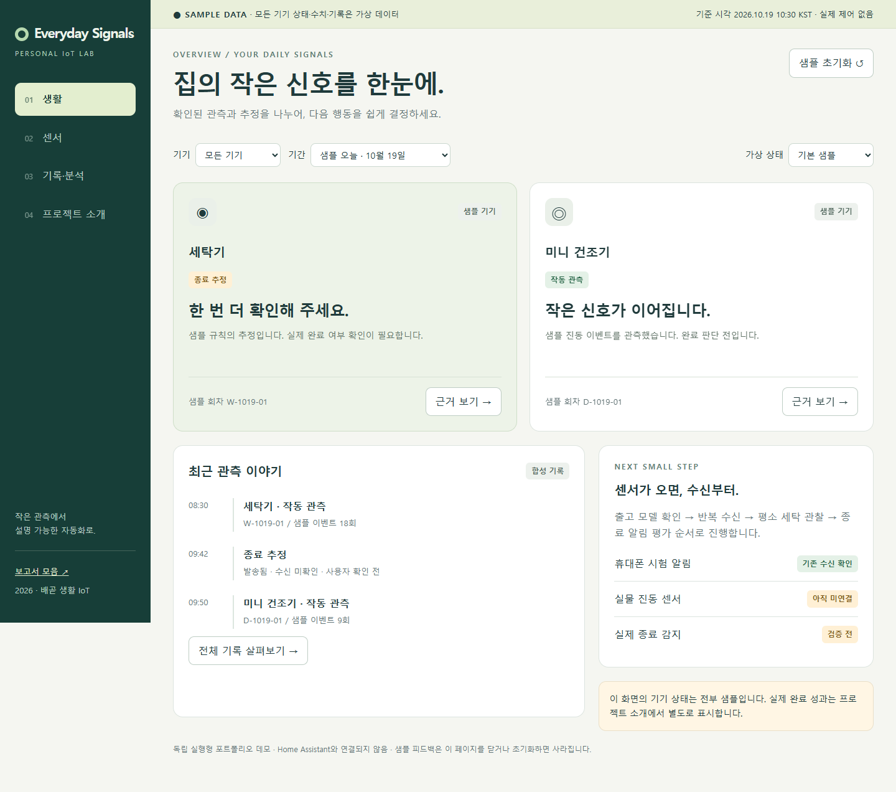

# Personal IoT Dashboard

## Everyday Signals — 샘플 포트폴리오

[샘플 대시보드 실행](https://feed-mina.github.io/personal_iot_dashboard/dashboard.html) · [전체 보고서 읽기](https://feed-mina.github.io/personal_iot_dashboard/) · [대시보드 HTML](dashboard.html) · [UI 참고 근거](reports/ui-reference-20261019.html) · [검증 결과](reports/dashboard-test-results.json)

저장소 ZIP을 다운로드하고 압축을 푼 뒤 **dashboard.html**을 열면 설치 없이 사용할 수 있습니다. 모든 상태·수치·기록은 합성 샘플이며 실제 가전·Home Assistant 연결이나 알림 전송은 없습니다.

- 생활·센서·기록/분석·프로젝트 소개 4개 화면
- 기기/기간 필터, 회차별 근거 창, 미연결·오래된 관측·오프라인·오류 시나리오
- 샘플 사용자 평가·수신 확인, 계산 분모 구분, 샘플 JSON 내보내기
- 외부 라이브러리/CDN/폰트 없이 독립 HTML 실행; 새로고침 시 샘플 초기화
- 실제 앱 시험 수신 성과와 샘플 데모, 향후 실측 목표를 분리

데스크톱 1440×1000 및 모바일 390×844 브라우저 검증 완료. 실제 센서 성능과 HA 실서비스 연동은 검증 범위가 아닙니다.

### 개발 검증

Node.js 환경에서 `npm install`, `npx playwright install chromium`, `npm test` 순서로 실행합니다. Windows의 기존 Edge를 사용할 경우 `PLAYWRIGHT_CHANNEL=msedge` 환경변수를 설정할 수 있습니다. 테스트는 임시 프로필만 사용하며 실제 가전과 연결하지 않습니다.

### 구현 구조와 다음 단계

`dashboard.html`은 샘플 모델/필터·집계 함수/화면 렌더링을 구분합니다. `tests/dashboard.cjs`는 사용자 시나리오를 검증합니다. 센서 도착 후 별도 인증된 데이터 어댑터를 만들어 연결할 계획이며, 브라우저나 공개 저장소에 HA 토큰을 넣지 않습니다. 현재 샘플을 실제 측정 성과로 제시하지 않습니다.

Home Assistant 생활 자동화 구축과 서울대 연구 연계 실험 기록입니다. 2026-10-19 기준.

## 보고서

- [전체 목록 HTML](index.html)
- [최신 Easy Guide](reports/easy.html)
- [최신 Fix Guide](reports/fix.html)
- [서울대 연구 연계 계획](reports/research.html)
- [기존 HTML 보고서 22개](reports/archive/)

GitHub Pages에서 [전체 보고서](https://feed-mina.github.io/personal_iot_dashboard/)를 바로 읽을 수 있습니다. [Easy Guide](https://feed-mina.github.io/personal_iot_dashboard/reports/easy.html) · [Fix Guide](https://feed-mina.github.io/personal_iot_dashboard/reports/fix.html) · [연구 연계 계획](https://feed-mina.github.io/personal_iot_dashboard/reports/research.html). GitHub 파일 화면은 HTML 소스를 표시합니다. ZIP을 내려받아 `index.html`을 열어도 됩니다.

## 확인된 상태와 한계

- G3 N100 Windows의 Home Assistant 운영 및 안드로이드 시험 알림 수신 확인.
- 기존 세탁기·미닉스 MNMD-120 유지. 종료 추정 알림은 센서 수령·실험 전.
- T1 출고 모델과 SLZB-06U 재고는 판매자 확인 대기. 구매 확정 아님.
- 첫 연구 주제: 저비용 진동 이벤트로 작동 종료를 추정하고 오알림·누락·지연을 측정.
- 서울대 연구 분야와의 연결은 프로젝트 제안이며 협업·입학·지원 자격 확정 아님.
- 가격과 링크는 작성 당시 기록이며 과거 보고서의 잘못된 권고는 최신 보고서를 우선합니다.

## 공개 범위

기존 HTML의 공개용 사본과 연구 계획만 포함합니다. 실제 내부 LAN IP는 자리표시자로 치환했습니다. Home Assistant 설정·계정·인증 토큰·백업·VirtualBox VDI·개인 이메일 기록은 포함하지 않습니다. 원본 보고서는 로컬에 그대로 보존됩니다.

## 진행상황 종합 업데이트

2026-10-19: 최신 Easy/Fix에 완료·대기·미검증 상태, 조건부 비용 123,610원, 11개 목표, 센서 도착일 기준 6주 추천 일정, 단계별 통과 기준과 연구 활용 계획을 추가했습니다. 신규 가격·판매자 답변·실물 연동은 이번 문서 갱신에서 재검증하지 않았습니다.

## UI·GitHub 레퍼런스 분석

[HTML 보고서](reports/ui-reference-20261019.html): 상용 모니터링 UI 4개, GitHub 프로젝트 8개, 현재 설정 기반 갭 분석, Props/State 명세, 단계별 적용 코멘트와 검증 계획. 공식 문서·소스 확인과 제안을 구분하며 실제 제품 구현·설치는 수행하지 않았습니다.
