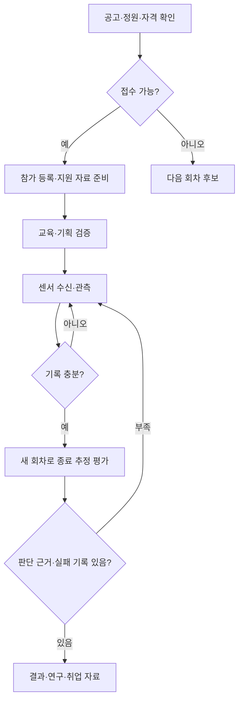

# IoT 실행 로드맵과 work-cycle 통합 GUI

2026-10-21 KST.

[인터랙티브 HTML](iot-action-roadmap-work-cycle-20261021.html)

## 결론

지금은 무료 AI 교육 접수와 경진대회 기획서를 우선 준비한다. 로드맵은 신청 → 자료 → 학습 → 센서 관측 → 검증 → 포트폴리오 순서이며, 실패 분기를 포함한다.

## 상태

- 서버·휴대폰 시험 알림: 10/19 과거 수신 확인 기록.
- 공개 대시보드: 샘플.
- 센서 구매·수신·종료 추정 성능: 미확인.
- work-cycle: Access 로그인 화면, 개인 화면의 소스 구조 확인. 운영 화면·저장값 미확인.
- Before는 구조 재구성 모형, After는 예상 GUI. 운영 기능·DB·일정은 변경하지 않음.

## 흐름

## 신청

- AI Agent 교육: 10/27, 선착순 조기 마감 가능. 기본정보·동기·가능일 준비. 폼 잔여 미확인.
- AI Platform Build Challenge: 10/25 17시 참가 신청, 23:59 PDF 20MB 이하 제출. 누구나 개인/1~3명. 자유양식. 6쪽은 추천 분량.
- 시흥 스타트업 교육: 화면상 11/13 00:00, 첨부 공고 대상·필수자료·회차 재확인 필요.

## work-cycle 적용 대안

|대안|범위|다음 검증|
|---|---|---|
|A|개인 메뉴·카드에서 공개 보고서 연결|한 번에 공식 신청 화면까지 이동|
|B 추천|로드맵 항목·기존 일정·메모·결과 연결|중복 추가 방지, 재방문 유지, 증거 없는 완료 방지|
|C 후속|사람이 검토한 실험 요약 연결|오래된 자료·중복·개인정보 처리|

회사용 사이클·기존 완료 규칙·알림 시각을 보존한다. 한 프로젝트로 시범 사용 후 취업·학습으로 확장한다. Home Assistant는 기기 실행, work-cycle은 계획과 검증 기록을 담당한다. 상세 구현은 이번 작업 범위에서 실행하지 않았다.

## GUI

- Before: 개인 사이클, 주간 스케줄, 메모가 개별 화면에 존재.
- After B: 로드맵 → 오늘 할 일 → 실행 기록 → 준비 현황 → 공개할 결과만 포트폴리오.
- 일정에 넣기 버튼은 HTML 안의 GUI 체험. 실제 저장 없음.
- 체크는 해당 브라우저에만 저장되며 접수·운영 상태와 동기화되지 않는다.

## 준비 일정

10/21 접수 화면 → 10/22~24 PDF 준비 → 10/25 공식 마감 → 10/27 교육 모집 → 선정 후 11월 교육 → 센서 도착 후 6주 실험 제안. 2027 공식 공고와 개인 준비 목표를 구분한다.

## 작업 지도

### 01 신청할 기회 고르기

지금 · 신청 여부 미확인

가전 알림과 샘플 대시보드는 준비했습니다. 교육·대회 신청 완료는 아직 확인하지 않았습니다.

- 무료 AI Agent 교육 신청 폼의 접수 가능 여부를 확인합니다.
- 경진대회는 10월 25일 17시까지 참가 등록하고, 같은 날 23시 59분까지 PDF를 냅니다.
- 일반인 공개 여부와 11월 오프라인 참석 가능일을 확인합니다.

완료 기준: 접수번호 또는 제출 완료 화면을 개인 기록에 남겼을 때만 “신청 완료”로 바꿉니다.

실패 대응: 마감·정원 초과이면 신청 완료로 표시하지 않고 다음 회차 후보로 옮깁니다.

### 02 지원 자료 묶기

준비 예정

기존 샘플 UI와 GitHub를 활용할 수 있습니다. 실측 성능이나 AI 모델 완성은 아직 주장할 수 없습니다.

- 문제·사용자·서비스 흐름·AI 역할·검증·일정의 6쪽 구성을 작성합니다.
- 현재 화면에는 “샘플 데이터”, 센서 실험에는 “계획”을 표시합니다.
- 직접 만든 부분과 오픈소스·AI 도구 출처, PDF 20MB 이하와 링크 열림을 점검합니다.

완료 기준: PDF가 정상 열리고 모든 주장이 완료 기록·샘플·계획 중 하나로 분류됐습니다.

실패 대응: 센서가 늦게 도착해도 합성 예시로 이용 흐름을 설명하고 실제 검증은 별도 계획으로 씁니다.

### 03 배우고 일정에 넣기

선정·참석 미확인

교육 접수와 선정·실제 참석은 각각 다른 상태입니다. 강의를 듣는 것만으로 센서 성능이 입증되지는 않습니다.

- 선정 통보 후 실제 참석 일정을 기존 work-cycle 주간 스케줄에 기록합니다.
- 교육 목표를 “이벤트를 요약하고 근거를 설명하는 작은 도구” 한 가지로 좁힙니다.
- 시흥 교육은 첨부 공고의 자격·회차·준비물을 확인한 뒤 신청합니다.

완료 기준: 참석 기록과 적용 결과 1개가 연결됩니다. 수료·선정 상태는 증빙이 있을 때만 기록합니다.

실패 대응: 행사 일정이 겹치면 무료 교육과 제출 기한을 우선하고 유료 강좌는 필요할 때만 고릅니다.

### 04 센서 1개로 관측

구매·연결 미확인

DJT12LM·SLZB-06U는 후보입니다. 판매자 모델·재고 답변과 실제 구매·도착·연결은 이 보고서에서 확정하지 않습니다.

- 모델·재고가 확인된 후 센서 1개만 준비합니다.
- 세탁기와 건조기에 번갈아 붙여 실제 흔들림과 수신 시각을 기록합니다.
- 시작·중간 멈춤·종료 시각은 사람이 별도로 기록합니다. 배터리형 진동 센서는 연속 파형 장비로 가정하지 않습니다.

완료 기준: 정상 수신·누락·설치 위치에 대한 기록이 있고 실제 종료 정답 시각과 비교할 수 있습니다.

실패 대응: 수신 누락이면 연결·배터리·거리부터 확인합니다. 반복 수신 빈도가 부족하면 이 센서로 종료 판별이 가능한지 다시 판단합니다.

### 05 종료 추정 검증

실험 예정

휴대폰 시험 알림 수신은 확인됐지만, 세탁·건조 종료 추정 성공은 아직 확인되지 않았습니다.

- 규칙을 정한 기록과 평가할 새 기록을 나눕니다.
- 오알림·놓침·지연·통신 끊김을 따로 셉니다. 세탁기와 건조기를 별도 평가합니다.
- 사람의 “맞음·아직 진행 중” 확인을 남기고 기준을 바꿨으면 새 회차로 평가합니다.

완료 기준: 기록 수·평가 조건·실패 사례가 공개 가능한 결과표에 함께 표시됩니다.

실패 대응: 일정 시간 조용하다는 이유만으로 완료 처리하지 않습니다. 중간 정지·오래된 관측은 확인 필요로 남깁니다.

### 06 결과를 다음 기회로

앞으로 할 일

집 IoT는 작은 실험 사례입니다. 산업 설비 진단 성능이나 대학 연구 참여가 확보됐다는 뜻은 아닙니다.

- 문제 정의 → 설계 선택 → 실패 → 수정 → 새 검증을 한 사례로 묶습니다.
- 서울대 연구의 센싱·시계열 품질·설명 근거 개념을 참고하되 실제 연구 참여와 구분합니다.
- 2027 공식 공고가 나온 뒤 나이 기준일·과거 이력·대학 소속·권역 조건을 다시 확인합니다.

완료 기준: 제출 가능한 1쪽 소개·실험 결과·데모·GitHub가 연결되고, 지원할 공고의 자격이 확인됩니다.

실패 대응: 현재 모집이나 역할 자격이 맞지 않으면 공개 교육·일반 팀빌딩·다음 회차 준비로 전환합니다.

## 출처

- [agent](https://www.seoul.ac.kr/snunow/events?bbsidx=177419&md=v)
- [agentform](https://forms.gle/WiEDvGFhgR2yyBHt8)
- [challenge](https://daker.ai/public/hackathons/ai-platform-build-challenge-prelims)
- [siheung](https://startup.sida.kr/business/support/detail/76)
- [research](https://feed-mina.github.io/personal_iot_dashboard/reports/research.html)
- [opportunities](https://feed-mina.github.io/personal_iot_dashboard/reports/iot-research-opportunities-20261021.html)
- [demo](https://feed-mina.github.io/personal_iot_dashboard/dashboard.html)
- [git](https://github.com/feed-mina/personal_iot_dashboard)
- [work](https://work-cycle.evolvix.workers.dev)
- [dsba](https://dsba.snu.ac.kr/projects/)
